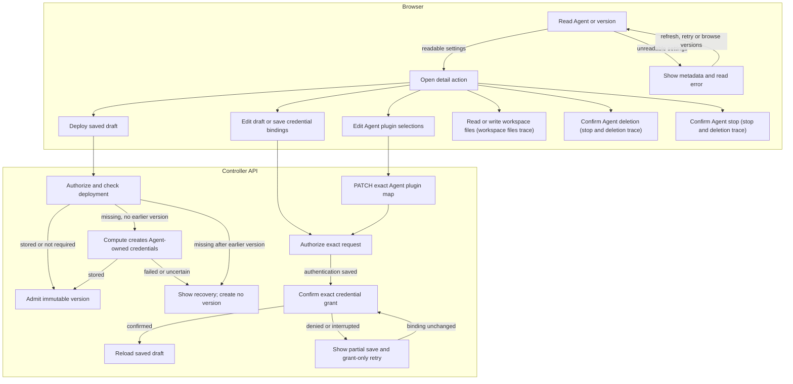

# Console Agent editing and runtime requests

## Overview

Related flows: [parent](../platform-console.md),
[workspace files](agent-workspace-files.md), [stop and deletion](agent-stop-and-deletion.md).

## Entry Points

- `apps/controller/src/console/agents/detail.mts:renderAgentDetail` loads the exact Agent and composes the detail actions.
- `apps/controller/src/console/agents/credentials.mjs:createChannelSecretsPanel` saves channel Secret bindings.
- `packages/occ/src/index.ts:OpenClawController.deployAgent` admits a version after first-deployment credential setup.
- Each action requires permission for its exact resource.

## Flow

## Execution Trace

### 4. Render draft, version, or channels

`apps/controller/src/console/agents/detail.mts:renderAgentDetail`

The page reads the Agent, readable versions, and the current Configuration for
`revision=draft` or Agent revision for `revision=<id>`. OCC uses `listAgents`,
`listRevisions`, `getAgentForBrowsing`, and `getRevisionForBrowsing`. A bad saved
Configuration payload returns metadata and `configurationReadError`; editing
and deployment fail closed. **Selected for service** uses `activeRevisionId`;
viewing a draft or saved version does not activate it. **Load older versions**
appends pages and retains selection. The picker marks stored deployment failures.

**Deployment** polls activity, the selected record, and diagnostics across tabs.
Transient read errors keep progress; denied reads clear cached evidence and `401`
expires the session. Refusals override successes, and stale responses are ignored.
**Retry** repeats failed reads. **Refresh deployment** rereads all status;
**Refresh record** keeps selection and focus. An unreconciled terminal result
requires a fresh read before recovery.

`agents/deployment-recovery.mts` places failure recovery above the summary;
`deployment-failure-steps.ts` classifies `deploy-again`, `logs` or `change`.
Denied log/version reads hide Logs for this sign-in. **Open Configuration** requires
Configuration `update`, bound Secret `operate`, and no known read denial.
Read-only **Open draft** and **Deploy again** (`deploy-again`) require `deploy` and readable
Configuration; the latter focuses **Deploy new version**. Credential recovery
requires Agent saves. Hidden/unlisted current versions suppress recovery; viewed
versions retain their results.
**Current observations** in `agents/deployment-diagnostics.mts` requests timestamped
`succeeded`, `failed`, or `unknown` diagnostics without changing deployment status.
Its bodyless POST requires Agent `read`/`operate` and exact Agent revision `read`.
**Open draft** opens the saved draft; **Deploy new version** admits its
Configuration/plugins. **Edit current Configuration** never copies historical
values. Deploy stays disabled while the Secret permission answer names a bound
Secret the caller may not `operate`, or counts one the caller may neither `read`
nor `operate`; that reason names no Secret (finding D756). After deployment, versions omitted from the newest page appear unreadable without
an audited read (finding D758).

**Edit Configuration** rereads the Agent and Configuration, then PATCHes only
`{ values, expectedGeneration }`, preserving `secretBindings`. A changed ID or stale
generation (also a racing save's `409`) requires **Reload draft**.
A response not confirming the same Configuration and Namespace, a newer generation, and the
sent values and bindings is an unknown outcome; reload before saving again.
A focused, disabled **Save Configuration** moves focus to **Checking Configuration…**.
Success focuses **Edit Configuration** unless the reader moved focus.

**Enable gateway password access** and **Collaboration and safety**
(`agents/gateway-safety.mts`) stage edits here; **Cancel** discards them. Password access sets `gateway.auth.password` to reference `OPENCLAW_GATEWAY_PASSWORD`, changing nothing else. Kubernetes
`gatewayConfiguration` recognizes the reference; `deployment` supplies the password.

Saves preserve scroll, focus and admitted snapshots. Rejected edits stay. Unsaved edits block deployment; pending saves block tab and version changes.
A refused write lists required grants without guessing which; a refused preflight read names read
access, a Workspace file save Agent `operate`. Without Agent `update`, Configuration `read` or
bound-source grants (`operate`, and `read` on a Harness ServiceAccount; the note names both),
plugins and repository access are summaries (dropping a kept plugin edit) and authentication is
disabled. Reads the answer refuses are skipped.
Lacking Configuration `update` makes Configuration and channels read-only; lacking `operate` on a
bound Secret does too, unless, for channels, each such Secret has a Slack token name; with nothing
editable, the draft says so and, without deploy, has no checklist.

`agents/plugin-fields.mts:createPluginFields` renders **Plugins**.
`agents/plugins.mts:savePlugins` rereads the Agent before PATCH. If its identity,
Configuration, selections, or approvers changed, the Console sends no write.
It clears the draft only when the response confirms the submitted settings.
**Reload plugin selections** discards the local draft and rereads without another
PATCH. The Plugin Driver validates and snapshots saved selections at deployment
([Agent plugin flow](../agent-plugins.md)).

**Repositories** uses `createRepositoryFields` with exact-Agent discovery and
PATCHes `repositoryAccess`. Unsaved edits also block tabs; failed discovery leaves
access unverified.

Deployment rereads Agent and Configuration, requires authentication and
Slack bindings, and blocks Teams. Changed association, generation, authentication,
plugins, execution mode, Backend, or repository access require reload; controls
stay locked while pending. Snapshot views deploy current settings. Failed reads
send no bodyless deploy POST; success opens the version. Uncertain POSTs require
history readback before retry; browser reads are not atomic with admission.

`apps/controller/src/console/drafts.mts:createDraftStore` holds document-local drafts.
Namespace and Agent keys isolate them; session expiry, user change, logout, exit,
and reload clear them. Drafts exclude passwords and never enter browser storage
or URLs. Baselines prevent stale saves; reload reapplies only non-overlapping edits.
Save and Cancel clear captures, while pending saves retain recovery guards.

`dom.mts:dismissOnBackdrop` requires press and click outside the topmost editor.
Like Escape, cancellation discards channel drafts, clears Secret inputs, and
retains plugin selections. Pending channel saves and Secret creation prevent dismissal.

`apps/controller/src/console/channels.mjs:renderChannels` renders Slack settings;
only **Open draft** permits editing. The
[console reference](../../reference/console/versions-and-channel-drafts.md)
owns Slack requirements and rejected native shapes; Teams remains native JSON.

`detail.mts:renderConfigurationTab` reads draft Harness authentication from the
Agent and admitted authentication and channel `secretBindings` from the version.
`agents/secret-picker.mjs` checks the source Namespace and exact Secret metadata.
For non-admin sessions, Agent detail first lists readable Namespace Secrets; it
does not issue exact reads for omitted Secrets. Refused exact reads remain audited.
The picker shows metadata only, distinguishes absent, loading, and unavailable
states, ignores stale responses, and expires current `401` sessions. It never
reads Secret values. Secret links open the metadata and consumers view.

`apps/controller/src/console/channels/slack.mjs:appendFields` separates channel
senders from DMs. Wildcard, empty, or omitted channel `users` selects **Allow
everyone**; explicit IDs fill the mutually exclusive input. Mention
requirements remain independent. `updatedSlack` replaces selected channels'
`users`, preserving DM and group policies, unrelated settings, and bindings.

The DM selector preserves omitted policies on existing configurations; new setup
starts with Allowlist. `validate` rejects empty/wildcard DM allowlists and
unsupported organization-wide policies. Selecting Open writes `allowFrom: ["*"]`;
leaving it for Allowlist or Pairing clears the wildcard input. Untouched lists
and native `dm.enabled` remain unchanged. Configuration save persists the
selection; redeployment applies it. See
[Slack policies](../../reference/configuration/secrets.md#native-channel-configuration).

`renderAgentDetail` supplies Namespace and bindings to the channel credential picker.
`GET /namespaces/:namespaceId/secrets` requires Namespace read and filters exact
Secret reads. The picker stages references only after selection; refresh rereads
metadata without saving. A refused permission check clears readable metadata and
blocks staging. Secret creation and binding choices are disabled when their
Namespace or per-Secret grants are insufficient. Save requires changed fields or
bindings and rereads permission answers after a refusal.

`openCreateSecretDialog` validates the Agent-prefixed name, value, and optional
Slack key before POST. Success stores the Secret and stages returned metadata;
cancellation does not delete it. Uncertain outcomes clear values and block retry
until refresh. See the [Secret storage flow](../secret-storage-and-delivery.md).

Channel saves reread the Agent and Configuration. A changed Configuration, service principal,
or generation requires **Reload draft** before a write or Secret grant. PATCH sends
`{ values, expectedGeneration }`, plus every binding after a Secret change; a save keeping a Secret
the caller cannot `operate` is refused before the PATCH, so **Disable** is offered disabled.
A save that rebinds such a Secret rereads the permission answer; Plugins, Repositories and the
authentication source follow it without a reload.

After PATCH, `apps/controller/src/console/agents/credential-access.mjs:ensureCredentialOperateBinding`
grants the Agent service principal access to selected Secrets through Namespace IAM. A failed
grant leaves Configuration saved; a 403 names the Installation administrator, who selects
**Retry Secret access**; a timeout or 5xx stays unknown. A member's session sends no grant and
says access was not verified until **Reload draft**. An administrator's console checks every
bound Secret's grant, as deployment does; Deploy waits for those reads and rechecks before its
POST, and a save or Retry during one reads again before naming Deploy.

For an Agent Author, OCC grants the Agent ServicePrincipal `operate` only on its bound Secrets
and credential sources in the Agent create, Agent update, or Configuration update transaction.
The Console makes no separate IAM write. The HTTP handlers use `transactIAM` for these writes.
For a session caller, the controller holds the admitted session through the resource write,
credential grants, and audit, then checks the session again before commit. Logout on another API
replica waits for this transaction; an expired session fails before commit. Service-key callers
use the ordinary transaction because they have no human session. After a replacement version
becomes active, OCC removes only generated grants the Agent no longer uses and preserves
administrator-created bindings. The selected IAM Driver must support transactional policy writes;
otherwise OCC refuses the change. Audit records each grant and removal.

`agents/credentials.mjs:missingChannelCredentialGroups` reads token keys as the Slack Channel
Driver does; pickers appear only for standard keys. A matching 400 shows the API
message. An uncertain PATCH blocks another channel write until Refresh. Disabling
a draft channel changes Configuration but does not stop a running Agent.

### 5. Save authentication and deploy the first version

`apps/controller/src/console/agents/detail.mts:renderAgentDetail` rereads the
Agent and rejects changed bindings before saving authentication. PATCH replaces
the prior Harness `credentialSources` entry, preserving unrelated entries without
deleting the old source or revoking grants. After PATCH,
`apps/controller/src/console/agents/credential-access.mjs:ensureCredentialOperateBinding`
grants the Agent service principal exact Secret (`api_key` or imported `codex_pat`)
or CredentialSource `operate` through the actor's IAM authority. Managed
ServiceAccount PATs and runtime authentication skip this grant.

Grant failure preserves saved authentication and freezes controls. `credentials.mjs:grantWarning`
names the outcome; members send no grant and get no retry. **Retry credential access**
rechecks identity and bindings before granting. Uncertain PATCH requires **Reload authentication
source**. Pending access survives navigation and holds deployment until confirmed or reloaded;
members' unverified grants do not. Administrator Namespace IAM denials also hold deployment.
Admission remains authoritative; confirmed access does not prove provider readiness.

Authentication and JSON Save preflight 403 call `detail.mts:retireSaveRead`. The shell's
`onProtectedReadDenied` clears that Agent's scoped drafts and retires its view before
completion handlers run. The causal receipt and request ID remain; history cannot restore data. Binding preflight uses the same boundary. Retry receipts preserve
prior saved-binding success and identify the failed read, without names or identifiers.
No write or grant starts on denied preflight. Transient reads and PATCH refusals keep their
contextual recovery. Lifecycle polling remains separately owned.

Deployment also authorizes the caller's Secret `operate` on each bound Secret. When the
Agent's `permissions/secrets` answer lists one, Deploy is disabled with a note naming it; a
generic deploy `403` rereads the answer and names them in its alert. A caller with Agent
`deploy` but neither update gets an answer only on the Secrets the draft binds.

**Operator-managed credentials** saves `{ "method": "runtime" }` without a source,
requiring readable version history and an unchanged draft. API authorization and
Driver compatibility remain authoritative.

**Open draft** shows bound Slack Secrets without proving live health.

`OpenClawController.deployAgent` checks transport credentials before admission.
Before the first version, Agent `read`/`operate` plus `deploy` authorize Compute
to check ownership/workloads and create missing whole Secrets, preserving matching
groups. Bytes enter neither Configuration nor audit.
Failure admits no version; retry rechecks status. Missing credentials after an
earlier version require operator investigation. Model/channel Secrets stay separate.

### 6. Read and replace live workspace files

`apps/controller/src/console/agents/workspace.mts:renderWorkspaceFiles`.
Moved to [Agent workspace files](agent-workspace-files.md#6-read-and-replace-live-workspace-files).

### 7. Request a stop and read back the Agent

`apps/controller/src/console/agents/stop.mts:createAgentStop`.
Moved to [Agent stop and deletion](agent-stop-and-deletion.md#7-request-a-stop-and-read-back-the-agent).

### 8. Confirm deletion and read back the Agent

`apps/controller/src/console/agents/deletion.mjs:createAgentDeletion`.
Moved to [Agent stop and deletion](agent-stop-and-deletion.md#8-confirm-deletion-and-read-back-the-agent).

## Debugging and Verification

- Run `node --test tests/browser/console-deployment-activity.test.ts`: Controller-backed
  disclosure, overlap, and refusal checks, not runtime proof.

- A denied Secret list requires collection `read`; a missing menu entry may lack
  exact Secret `read`.
- After a partial save, inspect Configuration, Secret metadata, and Agent IAM
  bindings before retrying; storage and binding do not prove runtime delivery.
- The [PostgreSQL integration](../../testing/postgresql.md) verifies that cross-replica logout waits for an Agent Author Configuration update and its credential grant to commit.
- After a plugin edit, compare saved `Agent.plugins` with the version's plugin
  snapshot; an Agent update installs or activates no plugin until a deployment.
- [Console failures](../../reference/console.md#failures-and-logout) covers session,
  permission, and network recovery.

## Related docs

- [Agent lifecycle reference](../../reference/agents.md#deletion)
- [Agent plugin flow](../agent-plugins.md)
- [Agent sharing flow](agent-sharing.md)

## Manual Notes

[keep this for the user to add notes. do not change between edits]

## Changelog

- 2026-10-29 11:38: Hold Agent Author sessions through Configuration and credential grant commits. (authoring-run/f1c9ee28-91e7-426f-a543-14adabf6bdeb - 0459f99245896167657d5965a4941ab1250045e1; accompanying uncommitted changes)

- 2026-10-29 12:43: Preserve overlapping overview and record reads. (authoring-run/22e56d10-b3c5-43f9-b088-c060fbfbe64f - 4af87e8139aafb7469b60cf38846935c1266baed)

- 2026-10-29 12:23: Retire denied Save views. (authoring-run/3ff450d4-971d-48f5-bb76-367dbfa06f25 - 5d8c060238a58)

- 2026-10-29 11:50: Track terminal overview reconciliation. (terminal-regrant - 1a16ee6c8ff11aaa0b8ea2451aabbc5445d8a72c)

- 2026-10-29 11:40: Share terminal overview refresh. (terminal-transition - 4f6e05487f336db326b46bd87fb3100ad99b660d)

- 2026-10-29 11:30: Share successful record reads. (same-record-recovery - aaa139e48b1ec5a56b7196da984b213df8fe5511)

- 2026-10-29 11:23: Preserve overlapping refusals. (overlap - d8283ec0f55caa496f6e0b750b61a2859fc7e100)

- 2026-10-29 11:19: Clear matching deployment evidence on selected-record refusal. (denial-coherence - e98223e893bcfb3ca23f0fb3ba4ea36af3a41f9d)

- 2026-10-29 11:04: Add Agent Author credential grants to the Agent editing flow. (authoring-run/2282a5a5-302e-4a87-b067-449b9b4f2e22 - 3d0b3b5454ecb6523180f5719d82e4c8e1426e52)

- 2026-10-29 10:27: Retain deployment progress through transient reads. (authoring-run/26ccef3f-405c-4275-bef-6c1722ae15c8 - bd67c46d5e5340e95d5e80bc850ebe41bc80f6ed)

- 2026-10-29 10:06: Describe transactional credential grants and replacement cleanup for Agent Authors. (authoring-run/32233c9b-0a2e-4472-ae28-676de3a66fcd - 3b9f76e11c3a7ffb5997de61c1e448370c521a92)

- 2026-10-29 03:49: Clear a completed Secret refresh hint while selection permission is pending. Accompanying uncommitted changes. (authoring-run/84c88245631c4882bd93c2140e0f313b - b81139ddfe086aca0e4da4eb5b9feedc8ac39d67)

- 2026-10-28 13:53: Keep the reader’s fold through routine polls and show failed record checks outside it. (fix-3285 - 14f6d94db)

- 2026-10-28 11:48: Quiet refresh (uncommitted). (authoring-run/4573d808-e28c-4e0f-8c52-faacba26092a - 8b5bee3ef01644cf7731f68794fe87d6b4b1d265)

- 2026-10-28 10:57: Clarify keyboard focus during record refresh. (authoring-run/7832bcaa-29cd-4303-99ce-edf549ad55d6 - e7f7c242158627219f6ce9d398c5cc034d721f7e)

- 2026-10-27: Credentials follows the default Slack account's keys and every bound Secret's grant; Deploy waits for grant reads. (findings 2526, 2529, 2540-2542, 2554, 2558, 2575)

[Console Agent editing documentation history](agent-editing/history.md) preserves the older dated entries.
