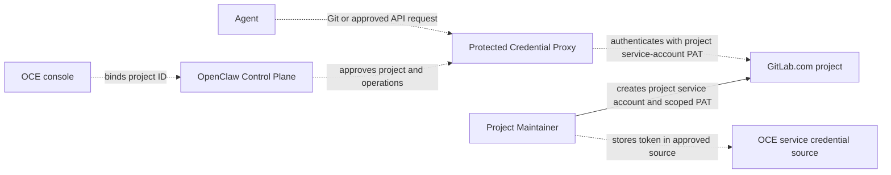

# Proposal: Support GitLab.com repository credentials

- **ID:** RFC-0023
- **Created:** 2026-10-21
- **RFC PR:** [#3137](https://github.com/openclaw/openclaw-enterprise/pull/3137)
- **Implementation plan:** [0023-gitlab-repository-credentials](../plans/0023-gitlab-repository-credentials.md)
- **Related:** [Feature request #3135](https://github.com/openclaw/openclaw-enterprise/issues/3135), [Credential Proxy proposal PR #2484](https://github.com/openclaw/openclaw-enterprise/pull/2484), [implementation PR #2487](https://github.com/openclaw/openclaw-enterprise/pull/2487)

## Summary

Add GitLab.com as a selectable provider so an Agent can clone, fetch, push, and create a draft merge request in one approved project without receiving its upstream token. Match the GitHub team runbook with a project-scoped non-human identity, a narrowly granted upstream credential held by the protected service path, a saved project binding, and server-side operation limits. Resolve the exact GitLab token creation and lifecycle path before implementation; the Credential Proxy and Token Service proposed in PR #2484 are not current main behavior.

## Motivation

The repository workflow currently supports GitHub. Its team runbook requires a GitHub App, the controller composes GitHubRepoDriver, and Agent session files include GitHub CLI configuration. Teams whose source of truth is GitLab cannot select those projects. They must mirror a project to GitHub or work without repository access.

A mirror creates another repository and review path that can drift. Working without repository access removes repository context from the Agent workflow. GitLab.com support lets teams keep their source and merge requests in GitLab while using OCE's managed repository workflow. This proposal makes no assumption about customer counts. [Feature request #3135](https://github.com/openclaw/openclaw-enterprise/issues/3135) records the reported gap and screenshot.

## Goals

- Add GitLab.com without replacing GitHub.
- Bind access to one approved project and an approved set of Git and API operations.
- Keep upstream credentials in the protected service path; authorize requests there.
- Support repository read/write and draft merge-request creation.
- Document setup, verification, expiry, rotation, and revocation.
- Deny missing, expired, revoked, wrong-project, and disallowed-operation requests.

## Non-goals

- Self-managed GitLab or configurable upstream hosts.
- Human-delegated access as the default team workflow.
- Merge, approve, or administer merge requests.
- Giving an Agent a GitLab token or general API access.
- Automatic token creation or rotation.
- Claiming this research spike tested a live GitLab.com project.

## Proposal

### Provider and project binding

Add GitLab.com through the existing Repo capability and lifecycle. The current Installation selects one Repo Driver, so initially select GitLab or GitHub for each Installation. Use the numeric project ID for API routing and canonical project path for repository URLs and display. Fix the origin to gitlab.com; reject Agent-supplied hosts, paths, or project IDs that do not match the saved binding.

The current RepoDriver contract returns GitHub-specific session files, and the GitHub client router accepts gh only. Decide how provider-specific clients and operations fit the Repo contract. Submit this RFC for human review before changing the Driver contract.

### GitLab mapping to the GitHub team runbook

The GitHub runbook uses an organization-owned App installed only on selected repositories. It stores the private key in the protected credential path, then binds and verifies access through the normal Agent workflow. GitLab's closest team-owned model is a project service account with a personal access token (PAT). It is project-bound, available on all GitLab.com tiers, and limited to 100 accounts per top-level group on Free. A top-level group Owner must verify identity. This model does not use GitHub's App installation and private-key flow. [GitLab service accounts](https://docs.gitlab.com/user/profile/service_accounts/)

| GitHub team runbook step                                                         | GitLab.com counterpart and gap                                                    |
| -------------------------------------------------------------------------------- | --------------------------------------------------------------------------------- |
| Create an organization-owned App; disable webhooks and user OAuth.               | Create a project service account; authenticate Git and API requests with its PAT. |
| Grant selected repository permissions and install on only intended repositories. | Assign the minimum project role and project-bound fine-grained grants.            |
| Record App, installation, and repository IDs.                                    | Save the project ID and canonical path; do not accept them from Agent input.      |
| Put the App private key in the protected service input.                          | Keep the PAT in the protected service credential path, outside Agent files/logs.  |
| Bind through the registry and use the normal Agent flow.                         | Bind the project; fix the host to gitlab.com and authorize every request.         |
| Verify changes and PR creation, then retire and rotate credentials.              | Verify Git and draft MR; deny other operations. Track expiry and rotate safely.   |

Service accounts can hold fine-grained PATs: GitLab's API documents `granular_scopes` on rotated service-account tokens. The statement that fine-grained-token enforcement excludes service accounts describes enforcement, not token capability. GitLab documents project-bound Code Download/Push and Merge Request Read/Create permissions. However, its project service-account token endpoint documents coarse scopes; fine-grained PAT creation for the current user is an experimental GraphQL mutation. Validate a supported setup before finalizing the runbook. If this requires a broad bootstrap token, revoke it before binding. Rotation preserves granular grants but revokes the old token when issuing its replacement, so update the protected credential as one controlled operation. [Fine-grained PATs](https://docs.gitlab.com/auth/tokens/fine_grained_access_tokens/), [Git and REST permissions](https://docs.gitlab.com/auth/tokens/fine_grained_access_tokens_other/), [service-account token API](https://docs.gitlab.com/api/service_accounts/), [GraphQL token creation](https://docs.gitlab.com/api/graphql/reference/experimental/mutations/#personalaccesstokencreate).

### Relationship to Credential Proxy work

Main currently implements the GitHub-specific path. [PR #2484](https://github.com/openclaw/openclaw-enterprise/pull/2484) proposes a protected Credential Proxy and Token Service, including approved static material and per-operation authorization. Its [GitHub implementation](https://github.com/openclaw/openclaw-enterprise/pull/2487) remains open; neither is current main behavior.

Review GitLab as a separate provider integration against that ownership model: Repo describes Git operations, the provider owns GitLab authentication and project grants, the protected service path authenticates each admitted request, and OCC owns binding approval and withdrawal. A manually created token does not refresh itself. Confirm how operators replace it and how the final Token Service handles expiry and withdrawal. Do not route protected Git through the legacy broker if PR #2484 selects the protected path.

### Research spike findings

This spike compared repository source and GitLab's published docs; it did not run live GitLab operations. Validate token creation and rotation before treating the procedure as an operator runbook.

### Architecture

Dashed connections are proposed; main does not implement the GitLab provider or this credential path.

## Delivery and verification

The [implementation plan](../plans/0023-gitlab-repository-credentials.md) tracks the work. Reconcile it with the final Credential Proxy decision from PR #2484 before implementation.

Use the regular Agent workflow against an authorized GitLab.com project. Verify allowed Git operations, draft merge-request creation, wrong-project and disallowed-route denials, missing/expired/revoked credentials, and token non-disclosure. Record the tier, project role, granular permissions, and environment. This spike compared published docs and source only; it provides no live-provider evidence.

## Rationale and alternatives

A project service account keeps contributions under a team-owned, non-human identity and supports GitLab.com Free. Service accounts can hold fine-grained PATs, and those grants can cover project-bound Git and REST API operations. The documented project-service-account API does not describe a stable fine-grained token creation procedure, so validate the provisioning and rotation path before selecting it. OCE must also enforce its own project and operation boundary even when the upstream PAT has narrow grants.

Keeping GitHub-only support avoids provider and token lifecycle work, but requires GitLab teams to mirror source or give up repository access. Extending the existing Repo capability gives them the same managed workflow without a second source of truth.

## Unresolved questions

1. **Credential maintainers:** Can the final Token Service hold a manually provisioned token and report expiry and replacement without treating it as a renewable credential?
2. **Credential maintainers:** Can a supported GitLab.com project-service-account flow create the required fine-grained PAT without an experimental or lingering broad token, and how should rotation preserve its grants without interrupting active bindings?
3. **Repo Driver maintainers:** Does the first release include draft merge-request creation, and which exact routes and methods are allowed? Merge and approval remain excluded.
4. **Product maintainers:** Is one provider per Installation sufficient, or must one Installation select both GitHub and GitLab projects?

## References

- [Repository credentials team runbook](../../docs/guides/repository-credentials/team-runbook.md)
- [Current repository credential reference](../../docs/reference/repository-credentials.md)
- [RepoDriver contract](../../packages/contracts/src/repo.ts)
- [GitHub-only composition](../../apps/controller/src/composition/repository-credentials/platform.ts)
- [GitHub client router](../../apps/controller/src/drivers/repo/github/credentials/client/router.ts)
- [RFC-0008: Repository credentials](0008-repository-credentials/index.md)
- [Credential Proxy proposal and implementation](https://github.com/openclaw/openclaw-enterprise/pull/2484), [PR #2487](https://github.com/openclaw/openclaw-enterprise/pull/2487)
- [RFC format example, PR #3050](https://github.com/openclaw/openclaw-enterprise/pull/3050)
- [GitLab service accounts](https://docs.gitlab.com/user/profile/service_accounts/)
- [GitLab fine-grained PATs](https://docs.gitlab.com/auth/tokens/fine_grained_access_tokens/)
- [GitLab fine-grained Git permissions](https://docs.gitlab.com/auth/tokens/fine_grained_access_tokens_other/)
- [GitLab fine-grained REST API permissions](https://docs.gitlab.com/auth/tokens/fine_grained_access_tokens_rest/)
- [GitLab service-account token API](https://docs.gitlab.com/api/service_accounts/)
- [GitLab GraphQL token creation](https://docs.gitlab.com/api/graphql/reference/experimental/mutations/#personalaccesstokencreate)
- [GitLab GraphQL fine-grained token creation](https://docs.gitlab.com/api/graphql/reference/experimental/mutations/#personalaccesstokencreate)
