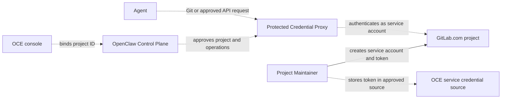

# Proposal: Support GitLab.com repository credentials

- **ID:** RFC-0023
- **Created:** 2026-10-21
- **RFC PR:** [#3137](https://github.com/openclaw/openclaw-enterprise/pull/3137)
- **Implementation plan:** [0023-gitlab-repository-credentials](../plans/0023-gitlab-repository-credentials.md)
- **Related:** [Feature request #3135](https://github.com/openclaw/openclaw-enterprise/issues/3135), [Credential Proxy proposal PR #2484](https://github.com/openclaw/openclaw-enterprise/pull/2484), [implementation PR #2487](https://github.com/openclaw/openclaw-enterprise/pull/2487)

## Summary

Add GitLab.com as a selectable provider so an Agent can clone, fetch, push, and create a draft merge request in one approved project without receiving its upstream token. Use a project service account as the proposed team identity. Resolve how its static token fits the Credential Proxy and Token Service proposed in PR #2484 before implementation; that proposal is not current main behavior.

## Motivation

The repository workflow currently supports GitHub. Its team runbook requires a GitHub App, the controller composes GitHubRepoDriver, and Agent session files include GitHub CLI configuration. Teams whose source of truth is GitLab cannot select those projects. They must mirror a project to GitHub or work without repository access.

A mirror creates another repository and review path that can drift. Working without repository access removes repository context from the Agent workflow. GitLab.com support lets teams keep their source and merge requests in GitLab while using OCE's managed repository workflow. This proposal makes no assumption about customer counts. [Feature request #3135](https://github.com/openclaw/openclaw-enterprise/issues/3135) records the reported gap and screenshot.

## Goals

- Add GitLab.com without replacing GitHub.
- Bind access to one approved project and an approved set of Git and API operations.
- Keep upstream credentials in the protected service path; authorize requests there.
- Support repository read/write and draft merge-request creation.
- Document setup, verification, expiry, rotation, and revocation.
- Deny missing, expired, revoked, wrong-project, and disallowed-operation requests.

## Non-goals

- Self-managed GitLab or configurable upstream hosts.
- Human-delegated tokens; repository access remains team-first.
- Merge, approve, or administer merge requests.
- Giving an Agent a GitLab token or general API access.
- Automatic token creation or rotation.
- Claiming this research spike tested a live GitLab.com project.

## Proposal

### Provider and project binding

Add GitLab.com through the existing Repo capability and lifecycle. The current Installation selects one Repo Driver, so initially select GitLab or GitHub for each Installation. Use the numeric project ID for API routing and canonical project path for repository URLs and display. Fix the origin to gitlab.com; reject Agent-supplied hosts, paths, or project IDs that do not match the saved binding.

The current RepoDriver contract returns GitHub-specific session files, and the GitHub client router accepts gh only. Decide how provider-specific clients and operations fit the Repo contract. Submit this RFC for human review before changing the Driver contract.

### Team identity and token choice

Use a project service account as the proposed team identity. GitLab.com service accounts are non-human and available on all tiers. The Free tier allows 100 per top-level group; Premium and Ultimate allow unlimited accounts. A top-level group Owner must verify their identity before use. Service-account tokens do not support fine-grained token permissions. [GitLab service accounts](https://docs.gitlab.com/user/profile/service_accounts/)

Keep the service account as a member of only the approved project and give it the minimum role for the workflow. Create a token with an expiry date. Its API scope can be broader than the operations OCE supports, so the protected service path must enforce the approved project, methods, and routes.

| Token option                             | Tradeoff                                                                                                                                |
| ---------------------------------------- | --------------------------------------------------------------------------------------------------------------------------------------- |
| Project service account token (proposed) | Team identity and all GitLab.com tiers. Service-account tokens lack fine-grained API permissions; enforce the OCE operation boundary.   |
| Project Access Token                     | Project bot identity, but GitLab.com requires Premium or Ultimate. Git and API may require both write_repository and api; api is broad. |
| Fine-grained personal access token       | All tiers and project-level Git/API permissions, but access and attribution depend on a human account.                                  |
| Deploy token                             | All tiers and read-only Git, but no public GitLab API; it cannot create merge requests.                                                 |

See GitLab's [Project Access Token](https://docs.gitlab.com/user/project/settings/project_access_tokens/), [scope](https://docs.gitlab.com/security/tokens/access_token_scopes/), [fine-grained permission](https://docs.gitlab.com/auth/tokens/fine_grained_access_tokens/), and [deploy token](https://docs.gitlab.com/user/project/deploy_tokens/) documentation. GitLab 19.2 makes fine-grained personal tokens generally available on all tiers, including project-scoped Git push and merge-request API permissions. That option does not match the existing team-first access model.

### Relationship to Credential Proxy work

Main currently implements the GitHub-specific path. [PR #2484](https://github.com/openclaw/openclaw-enterprise/pull/2484) proposes a protected Credential Proxy and Token Service, including approved static material and per-operation authorization. Its [GitHub implementation](https://github.com/openclaw/openclaw-enterprise/pull/2487) remains open; neither is current main behavior.

Review GitLab as a separate provider integration against that ownership model: Repo describes Git operations, the provider owns GitLab authentication and project grants, the protected service path authenticates each admitted request, and OCC owns binding approval and withdrawal. A manually created token does not refresh itself. Confirm how operators replace it and how the final Token Service handles expiry and withdrawal. Do not route protected Git through the legacy broker if PR #2484 selects the protected path.

### Research spike: GitLab.com runbook shape

The procedure appears feasible, but OCE does not yet provide a GitLab credential input:

1. Confirm the project is in a GitLab.com top-level group. Have its Owner complete required identity verification. Check the Free-tier service-account quota.
2. Have a project Maintainer create a project service account, keep it as a member of only that project, and assign the minimum role for the approved operations.
3. Create a service-account token with an expiry date. Record the numeric project ID and canonical path. GitLab shows the token only at creation; store it only in the future OCE service-owned credential path.
4. Register the project and token through the approved provider configuration, then bind it through normal repository selection. This registration path remains undecided.
5. Allow HTTPS to gitlab.com. With an authorized test project, verify allowed Git and draft merge-request operations, wrong-project and disallowed-route denials, and token non-disclosure.
6. Track expiry. On exposure, expiry, or access removal, revoke or replace the token, update the service credential, and authorize a new Agent binding. Closing an OCE session does not revoke the GitLab token.

This spike reviewed Enterprise source and GitLab's public documentation. It did not create a GitLab account, project, service account, or token, or test Git/API operations against GitLab.com. This is a researched runbook shape, not a working operator procedure.

### Architecture

Dashed connections are proposed; main does not implement the GitLab provider or this credential path.

## Delivery and verification

The [implementation plan](../plans/0023-gitlab-repository-credentials.md) tracks the work. Reconcile it with the final Credential Proxy decision from PR #2484 before implementation.

Use the regular Agent workflow against an authorized GitLab.com project. Verify allowed Git operations, draft merge-request creation, wrong-project and disallowed-route denials, missing/expired/revoked credentials, and token non-disclosure. Record the tier, project role, scopes, and environment. This spike provides no live-provider evidence.

## Rationale and alternatives

A project service account keeps contributions under a team-owned, non-human identity and supports GitLab.com Free. Its token lacks fine-grained API permissions, so OCE must enforce the approved operation set. A Project Access Token offers a direct project bot but requires a paid tier. A fine-grained personal token offers narrower grants but acts as a human. A deploy token supports read-only Git without API access.

Keeping GitHub-only support avoids provider and token lifecycle work, but requires GitLab teams to mirror source or give up repository access. Extending the existing Repo capability gives them the same managed workflow without a second source of truth.

## Unresolved questions

1. **Credential maintainers:** Can the final Token Service hold a manually provisioned token and report expiry and replacement without treating it as a renewable credential?
2. **Product maintainers:** Is Free-tier project service-account support required, or may the first release require Premium or Ultimate?
3. **Repo Driver maintainers:** Does the first release include draft merge-request creation, and which exact routes and methods are allowed? Merge and approval remain excluded.
4. **Product maintainers:** Is one provider per Installation sufficient, or must one Installation select both GitHub and GitLab projects?

## References

- [Repository credentials team runbook](../../docs/guides/repository-credentials/team-runbook.md)
- [Current repository credential reference](../../docs/reference/repository-credentials.md)
- [RepoDriver contract](../../packages/contracts/src/repo.ts)
- [GitHub-only composition](../../apps/controller/src/composition/repository-credentials/platform.ts)
- [GitHub client router](../../apps/controller/src/drivers/repo/github/credentials/client/router.ts)
- [RFC-0008: Repository credentials](0008-repository-credentials/index.md)
- [Credential Proxy proposal and implementation](https://github.com/openclaw/openclaw-enterprise/pull/2484), [PR #2487](https://github.com/openclaw/openclaw-enterprise/pull/2487)
- [RFC format example, PR #3050](https://github.com/openclaw/openclaw-enterprise/pull/3050)
- [GitLab service accounts](https://docs.gitlab.com/user/profile/service_accounts/)
- [GitLab fine-grained API permissions](https://docs.gitlab.com/auth/tokens/fine_grained_access_tokens_rest/)
