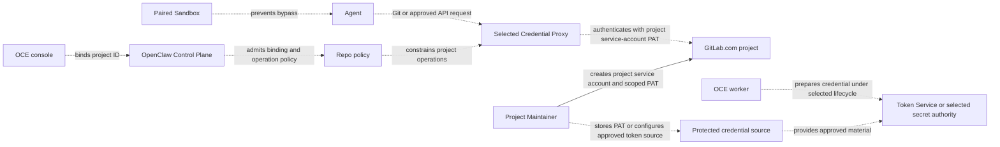

# Proposal: Support GitLab.com repository credentials

- **ID:** RFC-0024
- **Created:** 2026-10-21
- **RFC PR:** [#3137](https://github.com/openclaw/openclaw-enterprise/pull/3137)
- **Implementation plan:** [0024-gitlab-repository-credentials](../plans/0024-gitlab-repository-credentials.md)
- **Related:** [Feature request #3135](https://github.com/openclaw/openclaw-enterprise/issues/3135), [RFC-0023: Credential Proxy and credential lifecycle](0023-egress-proxy-credential-lifecycle/index.md), [implementation PR #2487](https://github.com/openclaw/openclaw-enterprise/pull/2487)

## Summary

Teams that keep their source in GitLab must mirror projects to GitHub or run Agents without repository access. We propose binding an Agent to one GitLab.com project by numeric ID. The selected Credential Proxy would authenticate approved Git and API requests with a project service account’s personal access token (PAT). The Agent would receive neither the PAT nor general access to the GitLab API.

Maintainers must choose who supplies and rotates the PAT. With an operator-supplied secret, the operator replaces the stored token after rotating it in GitLab. With a prepared-token provider, Token Service owns acquisition and retirement through a GitLab adapter. Both designs must deny requests when the binding is withdrawn or the credential is unavailable. The [existing GitHub implementation](https://github.com/openclaw/openclaw-enterprise/pull/2487) provides the binding and enforcement boundaries. GitLab token setup and runtime enforcement still need qualification.

## Goals

- Add GitLab.com without replacing GitHub.
- Bind access to one approved project and an approved set of Git and API operations.
- Keep upstream credentials in the protected service path; authorize requests there.
- Support repository read/write and draft merge-request creation.
- Document setup, verification, expiry, rotation, and revocation.
- Deny missing, expired, revoked, wrong-project, and disallowed-operation requests.

## Non-goals

- Self-managed GitLab or configurable upstream hosts.
- Human-delegated access as the default team workflow.
- Merge, approve, or administer merge requests.
- Giving an Agent a GitLab token or general API access.
- Automatic token creation or rotation.
- Claiming this research spike tested a live GitLab.com project.

## Proposal

### Provider and project binding

Add GitLab.com through the existing `repo` capability and lifecycle. Its `RepositoryPolicyDriver` currently exposes approved options and resolves bindings; it does not select a GitLab provider. Keep the first release to one provider per Installation unless review chooses otherwise. Use the numeric project ID for API routing and canonical project path for repository URLs and display. Fix the origin to `gitlab.com`; reject Agent-supplied hosts, paths, or project IDs that do not match the saved binding.

The current session-file contract includes GitHub CLI files, and the protected repository-delivery contract is explicitly Git and GitHub-installation scoped. The current GitHub client router accepts `gh` operations only. Define provider-specific client configuration and bounded operations without weakening these contracts. This RFC submits those Driver contract changes for human review.

### GitLab mapping to the GitHub team runbook

The GitHub runbook uses an organization-owned App installed only on selected repositories. It stores the private key in the protected credential path, then binds and verifies access through the normal Agent workflow. GitLab's closest team-owned model is a project service account with a personal access token (PAT). It is project-bound, available on all GitLab.com tiers, and limited to 100 accounts per top-level group on Free. A top-level group Owner must verify identity. This model does not use GitHub's App installation and private-key flow. [GitLab service accounts](https://docs.gitlab.com/user/profile/service_accounts/)

| GitHub team runbook step                                                         | GitLab.com counterpart and gap                                                    |
| -------------------------------------------------------------------------------- | --------------------------------------------------------------------------------- |
| Create an organization-owned App; disable webhooks and user OAuth.               | Create a project service account; authenticate Git and API requests with its PAT. |
| Grant selected repository permissions and install on only intended repositories. | Assign the minimum project role and project-bound fine-grained grants.            |
| Record App, installation, and repository IDs.                                    | Save the project ID and canonical path; do not accept them from Agent input.      |
| Put the App private key in the protected service input.                          | Keep the PAT in the protected service credential path, outside Agent files/logs.  |
| Bind through the registry and use the normal Agent flow.                         | Bind the project; fix the host to gitlab.com and authorize every request.         |
| Verify changes and PR creation, then retire and rotate credentials.              | Verify Git and draft MR; deny other operations. Track expiry and rotate safely.   |

### Capability parity with GitHub

Match task outcomes and access profiles, while using GitLab project and merge-request terms. The supported GitLab client must expose only the equivalent bounded operations; `glab` has additional commands that this proposal does not admit. The provider adapter may use `glab` or direct API requests, but must enforce OCE's operation limits independently of the upstream token's grants. [GitLab's CLI](https://docs.gitlab.com/cli/) provides the relevant project, issue, merge-request, and pipeline commands. Fine-grained Git permissions distinguish project code download from push, and REST grants include project-scoped merge-request reads and creation. [GitLab Git permissions](https://docs.gitlab.com/auth/tokens/fine_grained_access_tokens_other/), [REST permissions](https://docs.gitlab.com/auth/tokens/fine_grained_access_tokens_rest/).

| Profile and GitHub task                                                | GitHub usage                                                        | GitLab usage                                                                                                                                                                                                                                                |
| ---------------------------------------------------------------------- | ------------------------------------------------------------------- | ----------------------------------------------------------------------------------------------------------------------------------------------------------------------------------------------------------------------------------------------------------- |
| `git-read`: inspect project, issues, PRs, diffs, checks                | `gh repo view`, `gh issue list/view`, `gh pr list/view/diff/checks` | [`glab repo view`](https://docs.gitlab.com/cli/repo/view/), [`glab issue list/view`](https://docs.gitlab.com/cli/issue/list/), [`glab mr list/view/diff`](https://docs.gitlab.com/cli/mr/list/), [`glab ci status`](https://docs.gitlab.com/cli/ci/status/) |
| `git-write`: push branch; create or discuss draft PR; issues read-only | `git push`, `gh pr create --draft`, `gh pr comment`                 | `git push`, [`glab mr create --draft`](https://docs.gitlab.com/cli/mr/create/), [`glab mr note`](https://docs.gitlab.com/cli/mr/note/)                                                                                                                      |
| `git-full`: add issue creation and comments                            | `gh issue create/comment`                                           | [`glab issue create`](https://docs.gitlab.com/cli/issue/create/), [`glab issue note`](https://docs.gitlab.com/cli/issue/note/)                                                                                                                              |

Use the same opt-in project binding, per-binding profile selection, service-side credential custody, and normal Agent workflow as GitHub. The proposed draft merge-request operation accepts a branch already pushed to the bound project. If the branch is missing or belongs to another project, reject the request without pushing, forking, or creating a merge request. GitLab command names and setup screens may differ. Do not expand access to merge or approve merge requests, administer projects, or run, retry, or cancel pipelines. Enforce these limits in OCE even when a GitLab role or token allows more.

Service accounts can hold fine-grained PATs: GitLab's API documents `granular_scopes` on rotated service-account tokens. The statement that fine-grained-token enforcement excludes service accounts describes enforcement, not token capability. GitLab documents project-bound Code Download/Push and Merge Request Read/Create permissions. However, its project service-account token endpoint documents coarse scopes; fine-grained PAT creation for the current user is an experimental GraphQL mutation. Validate a supported setup before finalizing the runbook. If this requires a broad bootstrap token, revoke it before binding. Rotation preserves granular grants but revokes the old token when issuing its replacement, so update the protected credential as one controlled operation. [Fine-grained PATs](https://docs.gitlab.com/auth/tokens/fine_grained_access_tokens/), [Git and REST permissions](https://docs.gitlab.com/auth/tokens/fine_grained_access_tokens_other/), [service-account token API](https://docs.gitlab.com/api/service_accounts/), [GraphQL token creation](https://docs.gitlab.com/api/graphql/reference/experimental/mutations/#personalaccesstokencreate).

### Relationship to RFC-0023 and its implementation

RFC-0023 defines protected credential ownership. Its implementation in [PR #2487](https://github.com/openclaw/openclaw-enterprise/pull/2487) is merged: OCC owns admission, bindings, execution identity, expiry, and withdrawal; Token Service owns prepared credential acquisition, custody, and retirement; provider adapters own provider scope and protocol; the selected Credential Proxy and paired Sandbox enforce requests. Existing Repo and protected-delivery contracts remain GitHub-specific, so GitLab needs contract changes.

RFC-0023 remains Proposed. Its implementation does not qualify every protected runtime; the bundled OpenShell release remains unqualified for the joined enforcement guarantees. Select a live static secret or prepared-token provider for GitLab; do not assume the GitHub issuer supports GitLab. Define expiry, operator rotation, retirement, and withdrawal for the selected source.

### Architecture

Dashed connections are proposed GitLab behavior. The ownership components and the GitHub protected path exist in current code; GitLab provider support and qualification do not.

## Delivery and verification

The [implementation plan](../plans/0024-gitlab-repository-credentials.md) tracks contract changes, PAT lifecycle decisions, and qualification. The [RFC-0023 implementation](https://github.com/openclaw/openclaw-enterprise/pull/2487) does not prove GitLab behavior or qualify an OpenShell release.

Use the regular Agent workflow against an authorized GitLab.com project. Verify allowed Git operations, draft merge-request creation, wrong-project and disallowed-route denials, missing/expired/revoked credentials, and token non-disclosure. Record the tier, project role, granular permissions, and environment. This spike compared published docs and source; it did not run live GitLab operations.

## Rationale and alternatives

GitLab.com Free supports project service accounts, and fine-grained permissions can bound project Git and REST operations. The documented service-account API does not describe a stable fine-grained token creation procedure, so validate setup and rotation before selecting this path. OCE must enforce its own project and operation boundary.

Support lets teams keep GitLab as their source of truth and retain their review and CI path while using the managed workflow already available for GitHub.

## Unresolved questions

1. **Credential maintainers:** Should GitLab use a live static secret or a prepared-token provider? Which owner handles expiry, replacement, custody, and retirement for the selected source?
2. **Product maintainers:** Can a supported GitLab.com project-service-account flow create the required fine-grained PAT without an experimental or lingering broad token, and how should rotation preserve its grants without interrupting active bindings?
3. **Repo Driver maintainers:** Should the first release include the proposed draft merge-request operation or ship Git access first? If included, which routes and methods does it require? Merge and approval remain excluded.
4. **Product maintainers:** Is one provider per Installation sufficient, or must one Installation select both GitHub and GitLab projects?

## References

- [Repository credentials team runbook](../../docs/guides/repository-credentials/team-runbook.md)
- [Current repository credential reference](../../docs/reference/repository-credentials.md)
- [Repository policy contract](../../packages/contracts/src/repo.ts)
- [Protected repository-delivery contract](../../packages/contracts/src/protected-repository-git.ts)
- [Credential Proxy Driver contract](../../packages/contracts/src/credential-proxy.ts)
- [Current provider composition](../../apps/controller/src/composition/repository-credentials/platform.ts)
- [GitHub client router](../../apps/controller/src/drivers/repo/github/credentials/client/router.ts)
- [RFC-0008: Repository credentials](0008-repository-credentials/index.md)
- [RFC-0023: Credential Proxy and credential lifecycle](0023-egress-proxy-credential-lifecycle/index.md), [merged implementation PR #2487](https://github.com/openclaw/openclaw-enterprise/pull/2487)
- [RFC format example, PR #3050](https://github.com/openclaw/openclaw-enterprise/pull/3050)
- [GitLab service accounts](https://docs.gitlab.com/user/profile/service_accounts/)
- [GitLab fine-grained PATs](https://docs.gitlab.com/auth/tokens/fine_grained_access_tokens/)
- [GitLab fine-grained Git permissions](https://docs.gitlab.com/auth/tokens/fine_grained_access_tokens_other/)
- [GitLab fine-grained REST API permissions](https://docs.gitlab.com/auth/tokens/fine_grained_access_tokens_rest/)
- [GitLab service-account token API](https://docs.gitlab.com/api/service_accounts/)
- [GitLab GraphQL token creation](https://docs.gitlab.com/api/graphql/reference/experimental/mutations/#personalaccesstokencreate)
