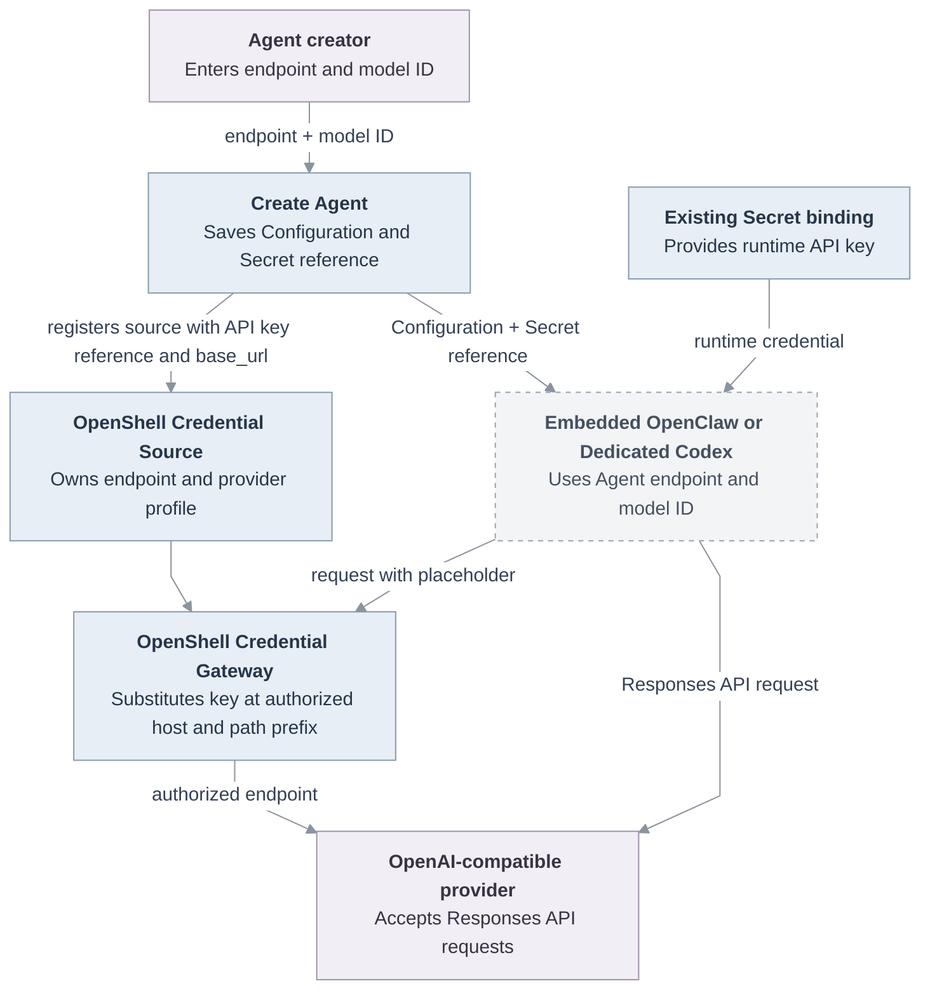

# Proposal: Per-Agent OpenAI-compatible endpoints with manual model selection

- **ID:** RFC-0024
- **Created:** 2026-10-20
- **Last updated:** 2026-10-23
- **Implementation plan:** [RFC-0024 implementation plan](../plans/0024-openai-compatible-model-endpoints.md)
- **Related:** [PR #913: Support OpenAI-compatible Codex model endpoints](https://github.com/openclaw/openclaw-enterprise/pull/913), [Create Agent reference](../../docs/reference/console/create-and-deploy.md), [Compute Driver contract](../../docs/reference/drivers/compute.md), [Harness execution](../../docs/reference/harness-execution.md)

## Decision requested

May an Agent creator who can use a shared model Secret choose the HTTPS provider that receives its key? This proposal grants that authority for Embedded OpenClaw and Dedicated Codex API-key Agents. For example, if a creator selects a shared Secret and enters `https://models.example.test/v1`, that provider receives the key when the Agent makes a model request. Maintainers must decide whether permission to use the Secret is sufficient or whether its owner must also authorize the destination.

An existing OpenShell Credential Source already binds its key to a destination. Selecting that source fixes the endpoint. To use another endpoint with Gateway-backed Codex, the creator must register a new source. For direct Secret delivery, the selected Harness Configuration owns the endpoint. A blank field uses the Installation default for Dedicated Codex when configured, then OpenAI. Embedded OpenClaw defaults to OpenAI. The creator enters the model ID for a custom provider.

## Motivation

OpenClaw Enterprise (OCE) Create Agent offers static OpenAI choices and manual model-ID entry, but no per-Agent endpoint. The starter Configuration points `models.providers.openai.baseUrl` to OpenAI. This proposal adds endpoint selection for Embedded OpenClaw and Dedicated Codex API-key Agents. Dedicated native OpenClaw has a separate provider-fenced Credential Gateway source.

Existing Configuration and Create Agent paths support provider `baseUrl` values, manual model IDs, and the existing `openai` provider identity. Reuse `apps/controller/src/drivers/openai-endpoint.ts` for server-side HTTPS and `/v1` validation; it rejects credentials, queries, fragments, wildcards, port `0`, and rewritten IPv4 forms, with no loopback HTTP exception. OpenClaw's [custom-provider guidance](https://github.com/openclaw/openclaw/blob/main/docs/concepts/model-providers/custom-providers.md) describes the same configuration pattern.

[PR #913](https://github.com/openclaw/openclaw-enterprise/pull/913) adds the Dedicated Codex API-key Responses path and `runtime.codexModelBaseUrl` Installation default. This RFC adds a per-Agent override and endpoint selection for Embedded OpenClaw. OCE's Gateway Driver binds keys to a Credential Source host and base-path prefix; Dedicated Codex reads that URL and calls the provider directly. OpenShell v0.1.4 requires custom profiles for alternate hosts and removed `inference.local`. Dedicated native OpenClaw uses a separate provider-fenced path; current Compute rejects custom source endpoints there, and [PR #2755](https://github.com/openclaw/openclaw-enterprise/pull/2755) proposes that runtime change.

## Goals

- Add an optional endpoint URL for OpenAI API-key Agents. Resolve Dedicated Codex endpoints in this order: per-Agent URL, configured Installation default, then OpenAI.
- Let users enter a model ID for custom endpoints and save the endpoint and model in Embedded OpenClaw or Dedicated Codex Agent Configuration.
- For Gateway-backed Dedicated Codex, register a new endpoint-bound OpenAI Credential Source; leave an explicitly selected existing source authoritative.
- Reuse the existing Secret binding and Agent HTTPS egress policy. Expose `runtime.codexModelBaseUrl` as `agentProvisioning.codexApiKeyBaseUrl` in the existing Compute capability for authorized Installation readers.

## Non-goals

- Remote model discovery or a model catalog refresh API. Consider this in a follow-up RFC or implementation change after manual endpoint use is qualified.
- Add a general provider registry, new credential type, model proxy, or browser-to-provider request.
- Add provider-specific authentication or claim compatibility for named providers without a runtime qualification.
- Add Chat Completions-only support to the shared OpenClaw and Codex path. Codex currently uses the Responses API.
- Add or broaden Agent egress, change provider-specific infrastructure, or claim that the configured hostname is allowlisted.
- Override the immutable endpoint of an existing Credential Source. A different endpoint requires a new source.
- Change Dedicated native OpenClaw's source-endpoint policy. Its custom endpoint support depends on the separate runtime work in [PR #2755](https://github.com/openclaw/openclaw-enterprise/pull/2755).

## Proposal

### Endpoint and manual model selection

Add an optional **OpenAI-compatible endpoint** field below the API-key Secret field in Create Agent. Show this field for OpenAI API-key authentication. For OpenClaw, the help text says: “Leave blank to use OpenAI (`https://api.openai.com/v1`). For another provider, enter its OpenAI-compatible base URL.” For Codex, also explain that a configured Installation endpoint is used when the field is blank.

When the endpoint is blank, retain the current OpenAI choices and manual-entry option. For a custom URL, use manual model entry, hide the static OpenAI list, and clear the selected model whenever the endpoint changes.

Validate the URL before saving and normalize it with the existing OpenAI endpoint helper. Require HTTPS and a base path that ends in `/v1`; reject wildcards, port `0`, embedded credentials, query strings, fragments, and IPv4 spellings that the URL parser changes. The current helper has no loopback HTTP exception. Do not make an HTTP request to the endpoint while editing or saving the form.

For direct Secret delivery, save the endpoint in the selected Harness Configuration: Embedded OpenClaw uses `models.providers.openai.baseUrl`; Codex uses `models.providers.codex.baseUrl`. Embedded OpenClaw defaults to OpenAI. Codex uses `runtime.codexModelBaseUrl` when configured, then OpenAI; a per-Agent URL takes precedence. For Gateway delivery, save the resolved endpoint on a new Credential Source and derive the Codex provider endpoint from that source. Store the custom model ID and display name without OpenAI-specific metadata. Keep the key in its Namespace Secret. Dedicated native OpenClaw keeps its Credential Gateway endpoint.

When Create Agent registers an API key through the Gateway, resolve the Agent URL, `agentProvisioning.codexApiKeyBaseUrl`, then OpenAI. Kubernetes Compute sets this capability from `runtime.codexModelBaseUrl` when configured. The endpoint is non-secret and appears only in the authorized Installation response. Save the resolved value as a new Credential Source `base_url`; the Gateway Driver builds its profile and Compute reads the same URL. OpenShell substitutes the key only at the profile's host and configured base-path prefix. A changed URL needs a new source; the field cannot override a source selected directly. This path supports Dedicated Codex, not Embedded OpenClaw.

### Create Agent interface mockup

Keep the current form layout and spacing in the supplied screenshot. Place the endpoint field between **API key Secret** and **Model**. For a custom endpoint, replace the static model chooser with manual model-ID entry.

```text
Agent name
[____________________________________________________________]

Model provider
Provider                         Harness
[OpenAI                       v] [Codex                        v]

Authentication method            API key Secret
[OpenAI API key               v] [Choose a model credential Secret v]

OpenAI-compatible endpoint (optional)
[https://models.example.test/v1______________________________]
Leave blank to use OpenAI (https://api.openai.com/v1). Dedicated Codex uses the configured Installation endpoint when set.
The model provider receives your API key. Check the URL and trust the destination. With OpenShell, the Credential Gateway binds the key to this endpoint.

Model
Model ID
[provider-model-id___________________________________________]
Enter the model ID listed by this endpoint.
```

With a blank endpoint, keep the existing **Choose a model** list and **Enter model ID manually** control. With a custom endpoint, show the manual field and do not imply that OCE has checked the model ID with the provider. Dedicated Codex must also allow manual entry when its Installation default points to a custom endpoint.

### Runtime use by OpenClaw and Codex

Embedded OpenClaw uses its provider Configuration; it does not use the OpenShell SandboxDriver. Direct Secret delivery sets `models.providers.codex.baseUrl`. Gateway-backed Codex derives the provider URL from the selected source's `base_url`; OpenShell substitutes the placeholder only at the profile's authorized host and base-path prefix. Dedicated Codex keeps `wire_api = "responses"` and uses `runtime.codexModelBaseUrl`, then OpenAI, when the Agent URL is blank. OAuth and Service Account authentication remain out of scope. Dedicated native OpenClaw stays outside this field; its source-owned endpoint policy is covered by [PR #2755](https://github.com/openclaw/openclaw-enterprise/pull/2755).

Both paths call `/v1/responses`. The pinned OCE runtime includes OpenClaw's custom-provider Responses transport, and Codex supports the Responses wire API. A catalog entry does not prove request or streaming compatibility. Qualify OpenAI, then one endpoint and model through real turns in both Harnesses; do not generalize that result to every compatible service.

### Credential, validation, and egress boundaries

The browser saves the URL and model ID; it does not call the endpoint. The proposed authority lets a creator with access to a shared model Secret send its key to any compatible HTTPS endpoint, without separate approval from the Secret owner. HTTPS and URL validation do not establish trust in the endpoint operator. The interface must disclose where the key goes. OpenShell binds a Gateway-delivered key to the source profile's host and base-path prefix, but it does not establish trust in that provider. Validate URLs with the existing OpenAI endpoint rules.

The current Compute-generated Agent NetworkPolicy permits IPv4 TCP/443 to `0.0.0.0/0` except `10.0.0.0/8`, `100.64.0.0/10`, `172.16.0.0/12`, `192.168.0.0/16`, and `169.254.0.0/16`. These exclusions cover private, carrier-grade NAT, and link-local ranges, but not every reserved range; `198.18.0.1` remains allowed. Reuse this policy without adding API or worker egress. It does not restrict traffic to the configured hostname; cluster networking must also allow HTTPS. Verify the five denied ranges and selected public endpoint in enforcing k3d. A restricted model proxy remains separate work under `TODO(model-egress-proxy)` and RFC-0017. Dedicated native OpenClaw retains the Credential Gateway's exact-host policy.



The diagram shows a proposed runtime path. It does not prove endpoint compatibility or deployment egress.

## Compute capability

This proposal extends the existing `ComputeAgentProvisioningCapabilities` contract with optional `codexApiKeyBaseUrl` and returns it in the authorized `GET /installation` response. It adds no route, model-discovery API, API egress rule, database entity, or credential format. It reuses the existing OpenAI Credential Source and OpenShell provider-profile path for Gateway-backed Dedicated Codex. Create Agent cannot automatically register the source when its caller cannot read Installation capabilities; the existing direct Secret path remains available where the selected Compute Driver permits it.

### Coordination with PR #2755

[PR #2755](https://github.com/openclaw/openclaw-enterprise/pull/2755) proposes custom endpoints for Dedicated native OpenClaw with `credential_source` authentication. It requires the endpoint to match the bound source, so Agent Configuration cannot redirect that credential. This RFC covers Embedded OpenClaw and Dedicated Codex API-key workflows, including Gateway-backed Codex. Do not treat #2755 as merged or as proof for the per-Agent API-key path.

## Delivery and verification

[The implementation plan](../plans/0024-openai-compatible-model-endpoints.md) owns the ordered changes and proof. Required proof includes:

1. Playwright for blank/default OpenAI and a custom endpoint, including model ID entry, endpoint changes, form validation, persisted Configuration, and error states. Update and inspect the matching Console Storybook scenarios and provide screenshots and a short video outside the repository.
2. Verify that `GET /installation` returns `agentProvisioning.codexApiKeyBaseUrl` to Installation readers when configured and omits it otherwise. Regenerate and check OpenAPI output for the response field; the operation and permission inventory do not change.
3. Real model turns through the supported OpenClaw and Codex workflows against OpenAI first, then a qualified compatible endpoint. Verify the selected endpoint, API-key use, and Agent egress. For Gateway delivery, verify the source profile permits the selected host and base-path prefix and denies a destination outside that profile. Fixtures alone do not prove provider or runtime compatibility.
4. Updated Create Agent, Codex, and execution-flow documentation. State that Dedicated native OpenClaw continues to use its Credential Gateway source endpoint. Keep the documented endpoint behavior aligned with the accepted RFC and deployed source.

RFC acceptance does not establish implementation or runtime availability. Missing enforcing k3d networking, endpoint access, or authorized credentials leaves the corresponding proof outstanding.

## Rationale and alternatives

Reuse the existing OpenAI Configuration provider, model Secret binding, and Codex Installation default. Omit OpenAI-specific metadata for custom Embedded OpenClaw models.

Remote discovery is deferred. `discoverAgentModels` and `ComputeDriver.discoverHarnessModels` support built-in catalogs at fixed URLs. Custom discovery needs endpoint validation, catalog requests, and API egress changes; assess it after manual endpoint use is qualified.

Use one endpoint field and the Responses API for both API-key workflows. Assess other protocols and provider-specific features after this path is qualified.

## Decisions and remaining proof

- **Agent egress:** Reuse the policy above; it does not allowlist the endpoint hostname. A restricted model proxy remains separate work.
- **Responses API qualification:** Use OpenAI first, then OpenRouter's documented beta Responses endpoint as the first candidate. Its docs do not prove every model works with both Harnesses. Require real streaming Agent turns with a tool call in both before claiming compatibility; record failures by request or stream behavior.

## References

- [OpenClaw custom-provider configuration](https://github.com/openclaw/openclaw/blob/main/docs/concepts/model-providers/custom-providers.md)
- [OpenClaw custom Responses transport support, merged upstream](https://github.com/openclaw/openclaw/issues/43018)
- [Codex model provider configuration](https://developers.openai.com/codex/config-reference)
- [OpenRouter Responses API reference](https://openrouter.ai/docs/api/api-reference/responses/create-responses) (qualification candidate only; not an OCE provider integration)
- [OpenShell v0.1.4 inference and custom endpoint guidance](https://docs.nvidia.com/openshell/v0.1.4/how-it-works/inference)
- [OpenShell v0.1.4 provider profiles and credential binding](https://docs.nvidia.com/openshell/v0.1.4/how-it-works/providers/overview)
- [OCE's pinned OpenClaw Responses transport](https://github.com/openclaw/openclaw/blob/f8386bc7df0a6c9eda7a28ae81943c5c06a414ff/packages/ai/src/transports/openai-responses-client.ts)
- [RFC-0004: Initial OCC Prometheus metrics](0004-occ-prometheus-metrics.md) and [RFC-0018: Installation profiles](0018-installation-profiles-design/index.md), accepted proposals with scoped delivery and verification records.
- [RFC-0022: Shared Driver configuration definitions](0022-driver-configuration-contributions.md), a merged proposal that remains `Proposed` pending its decision and implementation review.
